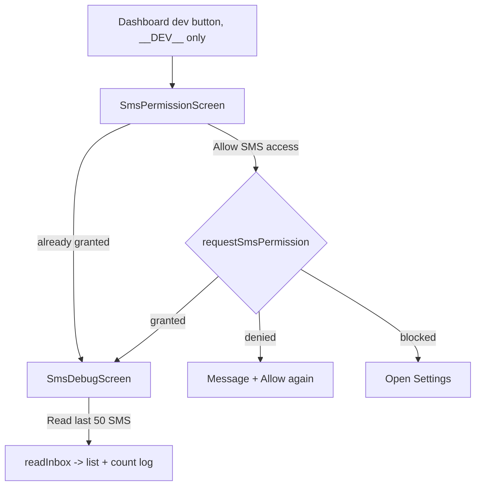

# SMS read proof of concept (Android)

## 1. New files created
| Path | Purpose |
|---|---|
| `src/features/sms/smsPermission.ts` | `checkSmsPermission()` / `requestSmsPermission()` → `'granted' \| 'denied' \| 'blocked'` |
| `src/features/sms/smsReader.ts` | `readInbox({ limit, minDate })` → `{ id, address, body, date }[]` (promise wrapper) |
| `src/features/sms/SmsPermissionScreen.tsx` / `.styles.ts` | Rationale + "Allow SMS access"; denied/blocked handling (Open Settings) |
| `src/features/sms/SmsDebugScreen.tsx` | Dev-only: "Read last 50 SMS", list of address, body preview, date; logs the count |
| `src/features/sms/SmsDevEntry.tsx` | Dev-only entry button on the dashboard (`__DEV__` only) |
| `src/app/sms-permission.tsx`, `src/app/sms-debug.tsx` | Routes; redirect to `/home` outside `__DEV__` |
| `src/types/react-native-get-sms-android.d.ts` | Types for the untyped library |
| `patches/react-native-get-sms-android+2.1.0.patch` | Build fix for the library (see §3) |
| `android/` | Generated by `expo prebuild` (git-ignored) |
| `docs/phase-01-sms-read.md` | This document |

## 2. Files changed
| Path | What changed |
|---|---|
| `app.json` | `android.package` = `com.intellivex.nafaqati`; `android.permissions` = `READ_SMS`, `RECEIVE_SMS` |
| `package.json` | Added `expo-dev-client`, `react-native-get-sms-android`, `patch-package` (dev), `postinstall: patch-package`; `android`/`ios` scripts now `expo run:*` (prebuild default); Expo patch versions aligned by `expo install --fix` |
| `src/app/(tabs)/home.tsx` | Renders `SmsDevEntry` |
| `src/components/Icon.tsx` | Added `sms` icon |
| `src/i18n/en.ts`, `ar.ts` | SMS strings (EN + AR) |

## 3. Business logic applied
- **Library choice:** `react-native-get-sms-android@2.1.0` is the only package that reads the SMS inbox; nothing maintained replaces it. It was last published in 2020 and its `build.gradle` does not build on this RN/Gradle (old AGP 3.3.1 classpath, `jcenter`, no `namespace`, a `react-native` artifact that no longer exists). Its Java sources are compatible with RN 0.86 (checked against the installed React Native sources). The patch only rewrites `android/build.gradle` and the library manifest (adds `namespace 'com.react'`, uses `com.facebook.react:react-android`, no `package=` attribute). `patch-package` re-applies it on every install.
- **Permissions:** READ_SMS and RECEIVE_SMS are declared via `app.json`. They are requested together at runtime. All granted → `granted`; any "never ask again" → `blocked`; otherwise `denied`. `check` cannot distinguish blocked, so it returns `denied` when not granted.
- **Reading:** `readInbox` queries the inbox sorted by date descending with `maxCount = limit` and optional `minDate`. Parsing failures and native errors reject the promise.
- **Dev-only:** the dashboard entry renders only when `__DEV__` is true, and both routes redirect to `/home` otherwise. No backend calls; SMS content is never stored or sent.
- **Play Store note:** READ_SMS/RECEIVE_SMS are restricted permissions; a production release needs a Play Console declaration. Out of scope here.

## 4. Flow after integration


## 5. Commands to run
Prerequisites: Android Studio (SDK + platform-tools), a JDK 17 (the JDK 26 on this PC is too new for Gradle/AGP), `ANDROID_HOME` set, USB debugging on, device visible in `adb devices`.
```bash
npm install                      # also applies the patch via postinstall
npx expo prebuild --platform android --clean
npx expo run:android --device    # builds the dev client and installs it
npx expo start --dev-client      # later runs
```
Then: log in (bypass) → dashboard → "SMS reader (dev only)" → Allow SMS access → Read last 50 SMS.

If Gradle fails in `:react-native-get-sms-android`, send me the error; the patch may need another tweak.
