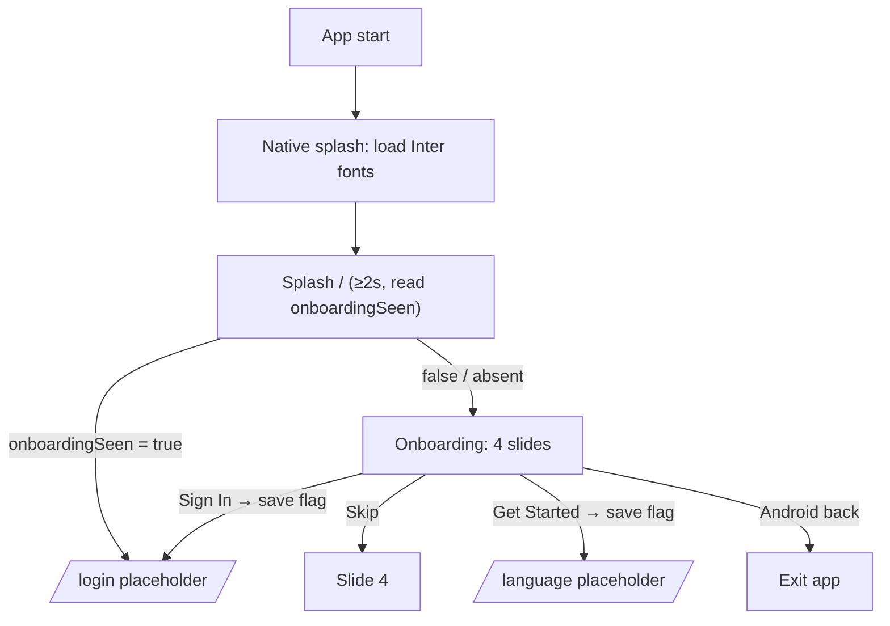

# Phase 01 – Splash + Onboarding

## 1. Summary
Adds the branded Splash screen and a 4-slide swipeable Onboarding flow to the Nafaqati mobile app (Expo SDK 57, Expo Router). The app routes on a persisted `onboardingSeen` flag. It makes no API calls. Language and Login are placeholder routes for later phases.

## 2. New files created
| Path | Purpose |
|---|---|
| `src/app/onboarding.tsx` | Onboarding pager screen (Skip, dots, Get Started, Sign In, back = exit) |
| `src/app/language.tsx` | Placeholder "Language selection - Phase 02" |
| `src/app/login.tsx` | Placeholder "Login - upcoming" |
| `src/theme/colors.ts` | Color + gradient tokens sampled from the design reference |
| `src/theme/typography.ts` | Inter font families, sizes, line heights |
| `src/theme/spacing.ts` | Spacing, radius, sizes (incl. 44px touch min), shadows |
| `src/theme/index.ts` | Theme barrel export |
| `src/i18n/strings.ts` | All visible strings (English) |
| `src/storage/flags.ts` | Typed `get/setOnboardingSeen` over AsyncStorage |
| `src/components/Logo.tsx` | SVG "N" logo, gradient rounded square, `size` prop |
| `src/components/PrimaryButton.tsx` | Blue button with loading/disabled states and an optional arrow that flips in RTL |
| `src/components/PaginationDots.tsx` | Page indicator, active dot blue/wide |
| `src/components/FeatureChip.tsx` | Floating chip (SVG icon + label), highlighted state |
| `src/components/PhoneMockup.tsx` | Phone illustration with 4 chips positioned by percentage |
| `src/components/Skyline.tsx` | SVG Riyadh skyline approximation for Splash |
| `src/features/onboarding/slides.ts` | 4 slides data (title, subtitle, highlighted chip) |
| `src/features/onboarding/useOnboarding.ts` | Pager index, skip, `finish()` (save flag + navigate) |
| `eslint.config.js` | Generated by `npx expo lint` on first run |
| `docs/phase-01-splash-onboarding.md` | This document |

## 3. Files changed
| Path | What changed |
|---|---|
| `src/app/_layout.tsx` | Root Stack (no header, fade), loads Inter fonts, holds/hides native splash |
| `src/app/index.tsx` | Now the Splash screen (route `/`) |
| `app.json` | name `Nafaqati`, slug `nafaqati-mobile`, scheme `nafaqati`, `userInterfaceStyle: light`, native splash bg `#060B2B` |
| `package.json` | name `nafaqati-mobile`; added `expo-linear-gradient`, `react-native-svg`, `@react-native-async-storage/async-storage`, `@expo-google-fonts/inter`, dev `eslint`, `eslint-config-expo` |

## 4. Business logic applied
- **Splash routing:** the Splash screen stays up at least 2s, with the logo fading and scaling in (Reanimated). It reads `onboardingSeen` while it waits. If the flag is false or absent, it calls `router.replace('/onboarding')`. If true, it calls `router.replace('/login')`. `/login` is a temporary target until the auth/token check is added.
- **Fonts:** the native splash stays visible until the Inter fonts load or fail, then `SplashScreen.hide()` runs.
- **onboardingSeen flag:** stored as `nafaqati.onboardingSeen` in AsyncStorage. Read errors return `false` and write errors are swallowed, so the worst case is that onboarding shows again.
- **Skip:** shown on slides 1–3. It scrolls to the last slide (slide 4).
- **Get Started:** shown on every slide, so slide 1 matches the design. It sets `onboardingSeen=true`, then calls `router.replace('/language')`. It shows a loading state and blocks double taps.
- **Sign In:** sets `onboardingSeen=true`, then calls `router.replace('/login')`.
- **Android back:** on Onboarding, the hardware back button calls `BackHandler.exitApp()`. Splash is replaced, so it is never in the back stack.
- **Status bar:** light content on Splash, dark on Onboarding and the placeholder screens.
- **i18n/RTL readiness:** all copy comes from `src/i18n/strings.ts`. Layout uses `start`/`end` and `paddingStart`/`paddingEnd` only. The button arrow mirrors when `I18nManager.isRTL`.
- **Responsive/a11y:** layouts use flex and percentages (the phone height is a % of the available space, and chips are placed by %), all inside safe areas. Buttons have `accessibilityLabel`/role and a touch target of at least 44px.

## 5. Flow after this integration


## 6. Design mapping
- **Source:** the requested 13-screen mobile mockup was not in the repo. The only reference is `nafaqati-web/assets/design-reference.png`, the web design. Its login panel provides the brand colors, logo, wordmark, tagline, purple/blue skyline and the "Powered by Intellivex Technologies" footer. As agreed, the screens follow the written spec plus tokens from that image.
- **Implemented:** Screen 1 (Splash) and Screen 2 (Onboarding).
- **Deviations:**
  - The Riyadh skyline is a simplified SVG (Kingdom Centre and Al Faisaliah silhouettes plus generic towers). No artwork asset exists.
  - The phone illustration is a vector skeleton UI, not a screenshot.
  - Chip icons are simple line SVGs.
  - Onboarding titles and subtitles for slides 2–4 are new copy.
  - Routes live in `src/app/`, not root `app/`. The project convention (AGENTS.md) and the existing setup use `src/app`, and Expo Router supports it.
  - The project stays in `fintech-mobile-app/` (renamed to `nafaqati-mobile` in package/app config) instead of a new folder, as agreed.

## 7. How to run and known limitations
```bash
npm install
npx expo start          # press a / i, or scan with Expo Go
npx tsc --noEmit
npx expo lint
npx expo-doctor
```
To see onboarding again, clear the app's storage (or reinstall).

**Known limitations**
- App icon, adaptive icons and the native splash image are still the Expo defaults. Only the native splash background color is branded.
- The horizontal pager has not been verified under RTL. Check it in Phase 02 when Arabic is enabled.
- The template packages `@expo/ui`, `expo-symbols`, `expo-glass-effect`, `expo-device`, `expo-image` and `expo-web-browser` are still installed but unused.
- The UI is light-only (`userInterfaceStyle: light`), because only the light design exists.

## 8. Next phase
Phase 02: Language selection (English/Arabic with RTL), then the Login screen.
