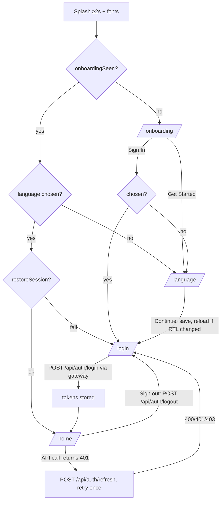

# Phase 02 – Language Selection + Login

## 1. Summary
Adds English/Arabic support (strings, fonts, RTL), the Language screen, and a Login screen connected to the real backend through the gateway (`/api/auth/*`). Tokens are held in memory, with the refresh token optionally in secure storage ("Remember me"). Refresh is single-flight and handles rotation. Phase 01 screens are moved onto the i18n layer and made RTL-safe. Forgot password and Sign Up are placeholders.

## 2. New files created
| Path | Purpose |
|---|---|
| `src/i18n/en.ts`, `ar.ts` | Typed dictionaries (`TranslationKey` derived from `en`, `ar` must match) |
| `src/i18n/index.ts` | `t(key)`, current-language getter/setter for non-React code |
| `src/i18n/LanguageProvider.tsx` | `useLanguage()` → `{ language, chosen, isRTL, setLanguage, t }`; RTL force + reload |
| `src/storage/language.ts` | AsyncStorage key `language` read/write |
| `src/api/http.ts` | axios factory (base URL from env, 30s timeout, `Accept-Language`) + `publicApi` |
| `src/api/client.ts` | `api` instance: Bearer interceptor, 401 → refresh → retry once |
| `src/api/errors.ts` | `toApiErrorInfo(error)` maps HTTP status to UI messages / field errors |
| `src/auth/tokenStore.ts` | In-memory access token; refresh token memory + secure-store; `rememberMe` flag |
| `src/auth/authApi.ts` | `login`, `refresh`, `logout` + `AuthResponse` type |
| `src/auth/session.ts` | `startSession`, `endSession`, single-flight `refreshSession`, proactive refresh timer |
| `src/auth/events.ts` | `sessionExpired` event emitter |
| `src/auth/AuthProvider.tsx` | `useAuth()` → `{ user, status, signIn, signOut, restoreSession }` |
| `src/components/AppText.tsx` | `Text` that picks Inter/Cairo by language and `weight` |
| `src/components/Toast.tsx` | Minimal toast (`showToast`, `ToastHost`) |
| `src/components/PlaceholderScreen.tsx` | "Coming in a later phase" |
| `src/hooks/useExitOnBack.ts` | Android back exits the app (Onboarding, Login, Home) |
| `src/features/language/Flags.tsx`, `LanguageCard.tsx` | SVG UK/Saudi flags; selectable card |
| `src/features/auth/AuthInput.tsx`, `Checkbox.tsx`, `useLogin.ts` | Login input, checkbox, form state/validation/submit |
| `src/app/forgot-password.tsx`, `register.tsx` | Placeholder routes |
| `src/app/home.tsx` | Placeholder "Home - Phase 03" with username and Sign out |
| `.env.example` | `EXPO_PUBLIC_API_BASE_URL` per device type |
| `docs/phase-02-language-login.md` | This document |

## 3. Files changed
| Path | What changed |
|---|---|
| `src/app/_layout.tsx` | Loads Inter + Cairo; wraps app in `LanguageProvider`, `AuthProvider`, `ToastHost` |
| `src/app/index.tsx` | New routing order (see §4); strings via `t` |
| `src/app/onboarding.tsx` | Strings via `t`; Sign In goes to `/language` when no language is chosen; shared back handler; pager direction pinned LTR |
| `src/app/language.tsx`, `login.tsx` | Replaced placeholders with real screens |
| `src/features/onboarding/slides.ts`, `useOnboarding.ts` | Slides hold translation keys; `finish(source, target)` |
| `src/components/PrimaryButton.tsx`, `FeatureChip.tsx`, `PhoneMockup.tsx`, `PaginationDots.tsx` | `AppText`/`t`; dots row pinned LTR to match the pager |
| `src/theme/typography.ts`, `index.ts` | `fonts` replaced by `fontFamily(weight)` (language-dependent) |
| `src/theme/colors.ts`, `spacing.ts` | Added danger, flag colors and sizes for new components |
| `src/i18n/strings.ts` | Removed (moved to `en.ts`/`ar.ts`) |
| `package.json`, `app.json` | Added axios, expo-secure-store, expo-localization, @expo-google-fonts/cairo, expo-updates; config plugins |

## 4. Business logic applied
- **Language persistence:** AsyncStorage key `language` (`en`/`ar`). No value means `chosen = false`, which sends the user to the Language screen. The Language screen pre-selects the device locale (`ar` or else `en`). Selecting a card only changes local state; **Continue** saves and then routes to `/login`.
- **RTL reload rule:** `setLanguage` saves the language first, then calls `I18nManager.allowRTL(true)` and `forceRTL(isArabic)`. If the native direction changed, it reloads (`Updates.reloadAsync`, or `DevSettings.reload` in dev). On startup the provider re-syncs direction to the stored language (no language = LTR) and reloads if they differ.
- **Fonts:** Inter for English, Cairo for Arabic, resolved at render by `AppText` / `fontFamily(weight)`.
- **Token storage:** the access token is memory only. The refresh token is always kept in memory. With `rememberMe` it is also saved in secure-store (`refresh_token`, with `remember_me`); without it, the secure-store entries are deleted. Closing the app without "Remember me" therefore logs the user out.
- **Single-flight refresh + rotation:** all callers share one in-flight refresh promise. The **new** refresh token replaces the old one in memory before anything else is awaited, then is persisted if `rememberMe`. A refresh rejected with 400/401/403 clears the session and emits `sessionExpired` (toast "Session expired" + `/login`). Network errors or 5xx do not clear the session. A proactive refresh runs about 60s before `expiresIn` (seconds).
- **401 handling:** a 401 on an `api` call triggers one refresh and one retry of the original request. Auth endpoints use `publicApi` and never enter this path.
- **Error mapping (by status only):** 400 with `fieldErrors` → per-field messages under inputs; 401 → "Invalid credentials"; 429 → "Too many attempts, please wait a moment"; 502/503/504 → "Service temporarily unavailable"; no response (network/timeout) → "Check your connection"; anything else → generic message. Generic errors show in a banner above the button.
- **Validation:** identifier trimmed, required, max 255; password required, max 72 (not trimmed).
- **Navigation order (Splash):** after the 2s animation and fonts: onboarding not seen → `/onboarding`; language not chosen → `/language`; `restoreSession()` succeeds → `/home`; else `/login`. `restoreSession` is only called once the first two checks pass.
- **Back button:** Android back exits from Onboarding, Login and Home.
- No tokens or passwords are logged; the project has no `console.*` calls.

## 5. Flow after this integration

## 6. Backend contract used
All calls go to the gateway (`EXPO_PUBLIC_API_BASE_URL`, port 8080), JSON, with `Accept-Language: en|ar`.
| Endpoint | Request | Response |
|---|---|---|
| `POST /api/auth/login` | `{ identifier, password, rememberMe }` | `AuthResponse` |
| `POST /api/auth/refresh` | `{ refreshToken }` | `AuthResponse` (new rotated `refreshToken`) |
| `POST /api/auth/logout` | `{ refreshToken }` | `{ message }` (result ignored) |

`AuthResponse = { id, username, email, role, accessToken, refreshToken, tokenType, expiresIn }` (`expiresIn` in seconds).
Errors: `{ timestamp, status, error, message, path, fieldErrors? }`. 429 has an empty body; 502/503/504 have `{ status, error }`. The app branches on status only.

## 7. Design mapping + deviations
- `nafaqati-web/assets/design-reference.png` is a single collage. The Language screen and the Sign Up screen are **not visible in it**, so the Language screen follows the written spec (title, two cards, blue border + check, blue Continue). Login reuses the "Welcome Back" card in the reference (logo, label-above rounded inputs, eye toggle, Remember me / Forgot password, blue button, footer link).
- No Google/Apple buttons (not supported by the backend) and no Email/Mobile tabs (only `identifier`).
- The onboarding pager keeps left-to-right paging in Arabic (slide text and chips are RTL) to avoid platform RTL scroll-offset differences.
- The flags are simplified SVG approximations.
- `X-Correlation-Id` was skipped (optional) to avoid adding a uuid dependency.

## 8. How to run
1. Copy `.env.example` to `.env.local` and keep one URL: Android emulator `http://10.0.2.2:8080`, iOS simulator `http://localhost:8080`, physical device `http://<LAN-IP>:8080` (same Wi-Fi, firewall allowing 8080).
2. Start the backend (gateway + auth-service + Redis/DB as needed) and run `npx expo start`. Restart Expo after changing env values.

Known limitations: cleartext `http` may need a development build on physical Android; switching language reloads the app by design; Expo Go reload for RTL uses `DevSettings.reload`; token persistence relies on secure-store availability (falls back to memory-only); the pager and RTL layouts were not checked on a device in this phase (see report).

## 9. Next phase
Phase 03: Home/dashboard shell and the first authenticated API calls (replace the `/home` placeholder).
