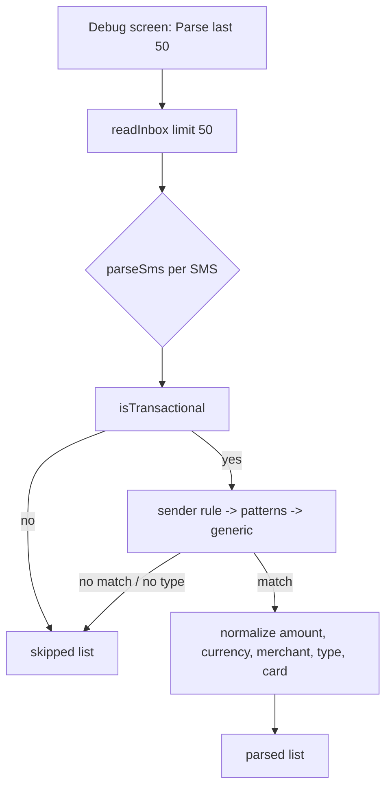

# Phase 02 – SMS parser (SMS → structured transactions)

Pure TypeScript, no network, nothing stored.

## 1. New files created
| Path | Purpose |
|---|---|
| `src/features/sms/parser/types.ts` | `ParsedTxn` |
| `src/features/sms/parser/filter.ts` | `isTransactional(body)` + keyword regexes shared with the parser |
| `src/features/sms/parser/rules.ts` | Per-bank rule array + generic fallback |
| `src/features/sms/parser/parseSms.ts` | `parseSms(sms)` → `ParsedTxn \| null`, never throws |
| `src/features/sms/parser/parseSms.test.ts` | 39 fixture tests (Vitest) |
| `src/features/sms/SmsParseResults.tsx` | Debug list: parsed rows + skipped/unparsed bodies |
| `docs/phase-02-sms-parser.md` | This document |

## 2. Files changed
| Path | What changed |
|---|---|
| `src/features/sms/SmsDebugScreen.tsx` | Added "Parse last 50" button; shows parsed/skipped counts and lists |
| `src/i18n/en.ts`, `ar.ts` | Three new debug strings |
| `package.json` | `vitest` (dev) and `test` script. No test runner existed, so this was the one allowed addition |

## 3. Business logic applied
1. **Filter** (`isTransactional`): rejects OTP/verification text and promos (offer, discount, congratulations, apply now, عرض, اربح…). Then requires an amount next to a currency (Rs/PKR, SAR/SR/ر.س/ريال, AED/درهم) **and** a debit/credit keyword. Balance-only alerts have no keyword, so they are rejected.
2. **Rule choice:** every rule whose `senderMatch` matches the address is tried in array order. The generic rule matches any sender and is last, so a known bank whose patterns fail falls back to generic. First pattern with `amount` + `currency` wins.
3. **Normalization:** Arabic-Indic digits → Western; `,` and `٬` removed; `٫` → `.`; the amount stays a **string** (`"1250.00"`); zero amounts are rejected. Currency → `PKR`/`SAR`/`AED`. Merchant: whitespace collapsed, trailing punctuation trimmed, empty → `null`.
4. **DEBIT/CREDIT:** the earliest *strong* keyword wins (debit: spent, debited, purchase, paid, withdrawn/withdrawal, sent, خصم/شراء/دفع/سحب; credit: credited, received, deposit(ed), إيداع). POS/ATM alone are weak and mean DEBIT only when no strong keyword exists.
5. **Card last 4:** from the first of `card / a/c / account / ending / ** / xx` followed by digits (last 4 of the run).
6. **Bank field:** the matched bank name, or the sender address when the generic rule matched.
7. Returns `null` if the filter rejects, no pattern matches, or amount/currency/type can't be determined; any exception also returns `null`.
8. **Adding a bank:** append one entry to `rules` in `rules.ts` (before the generic entry). Use `{CUR}`, `{AMT}`, `{END}` placeholders and the named groups `currency`, `amount`, `merchant`.

Assumptions and simplifications:
- The sample formats are my approximations of each bank's wording with fake numbers, not real captured messages. Real SMS will differ, which is what the debug screen is for.
- Credits only capture a merchant when the text has "from X". Debits take "at X" (or "to X" for ABL and NayaPay).
- A bare number after `account` within 12 characters can be mistaken for a card number.
- Only PKR, SAR and AED are recognised. Unknown currency words make the SMS unparsed.
- Tests run in Node (V8). The parser uses lookbehind, named groups and `replaceAll`, which Hermes supports, but this still needs the on-device check below.

## 4. Flow after integration

The debug screen shows `Parsed: N · Skipped/unparsed: M`, then parsed rows (type, formatted amount, bank, merchant, card) and every skipped message body (selectable text so you can copy it).

## 5. Commands
```bash
npm test                          # run the parser tests
npx tsc --noEmit
npx expo lint
npx expo run:android --device     # build + install the dev client
npx expo start --dev-client       # later runs
```
On the phone: dashboard → "SMS reader (dev only)" → allow SMS → **Parse last 50**. Copy skipped bodies into new rules (or send them to me with the numbers masked).
