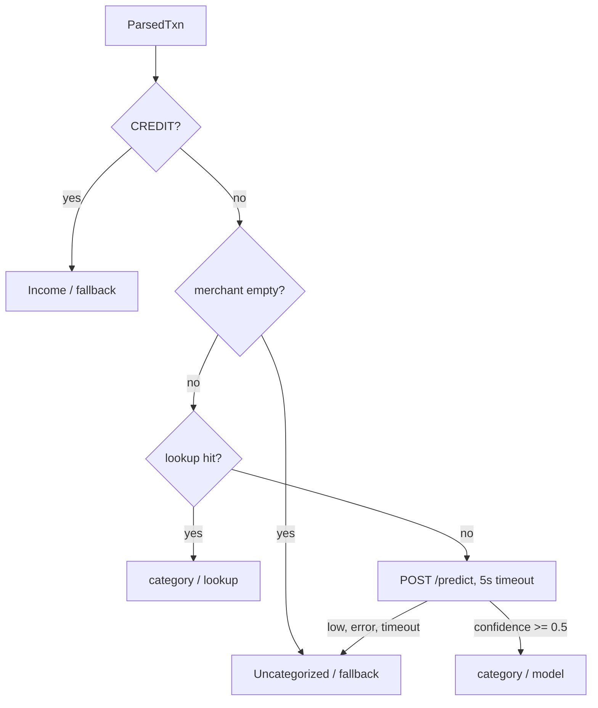

# Phase 03 – Categorizer (lookup → model → fallback)

## 1. New files created
| Path | Purpose |
|---|---|
| `src/features/categorizer/lookup.ts` | `lookupCategory(merchant)`: normalized, longest-pattern, token-boundary match |
| `src/features/categorizer/modelClient.ts` | `predictCategory(text)`: POST `/predict`, 5s timeout, never throws |
| `src/features/categorizer/categorize.ts` | `categorize(txn)` → `{ category, source, confidence? }` |
| `src/features/categorizer/merchantLookup.json` | 6,178 `{ pattern, category }` entries (generated) |
| `src/features/categorizer/categorize.test.ts` | 10 Vitest tests (fetch mocked) |
| `src/config/env.ts` | `API_URL`, `CONFIDENCE_THRESHOLD = 0.5` |
| `vitest.config.mts` | Maps the `@` alias so tests can import `@/…` |
| `merchant_api_project/scripts/export_lookup.py` | One-off export of the lookup JSON (lives in the model project) |
| `docs/phase-03-categorizer.md` | This document |

## 2. Files changed
| Path | What changed |
|---|---|
| `src/features/sms/SmsDebugScreen.tsx` | "Parse + categorize last 50" button |
| `src/features/sms/SmsParseResults.tsx` | Shows category · source · confidence per row and counts per source |
| `src/i18n/en.ts`, `ar.ts` | One new button label |
| `app.json` | `expo-build-properties` with `android.usesCleartextTraffic: true` |
| `.env.example` | `EXPO_PUBLIC_API_URL` and device notes |
| `package.json` | `expo-build-properties` (see below) |

**New dependency:** `expo-build-properties` is the supported Expo way to turn on cleartext HTTP for Android. The app needs it because the model API is plain `http://`.

**Model project (`main.py`) was not changed.** The existing `/predict` already returns `input_text`, `category` and `confidence` (rounded to 4 decimals, the probability of the predicted class), so it already meets the requirement. It also returns extra fields. The model files are untouched.

## 3. Business logic applied
Order in `categorize(txn)`:
1. **CREDIT** → `{ Income, source: 'fallback' }`. Credits never reach the lookup or the model. (Simplest reading of "lookup/fallback only": the lookup holds expense categories, so Income is always the fallback.)
2. **Empty/null merchant** → `{ Uncategorized, 'fallback' }`, no model call.
3. **Lookup hit** → `{ category, 'lookup' }`.
4. **Model** (`/predict` with the merchant string): `confidence >= 0.5` → `{ category, 'model', confidence }`.
5. Otherwise (low confidence, timeout, network error, bad response) → `{ Uncategorized, 'fallback' }` (confidence included when the model answered).

**Lookup:** the text is lowercased, apostrophes removed, and everything except `a-z` and Arabic letters becomes a space, so digits and punctuation noise are gone. A pattern matches only on whole tokens (padded with spaces), and the longest pattern is tried first. Patterns under 3 characters after normalization are ignored, which covers the `J.` bug.

**Lookup export:** `Merged` sheet, `merchant_pattern` split on `|`, lowercased, patterns under 3 characters dropped, de-duplicated. Category comes from `category_normalized`. Patterns that map to more than one category (137) are dropped, because I can't tell which one is right. The source file was found at `D:\Datasets\LLM_generated.xlsx`.

**Things to know:**
- The server applies its own 0.70 rule and may switch to a verified merchant or Gemini category when `GEMINI_API_KEY` is set. The returned `confidence` is still the original ML probability. So a good LLM category can show a low confidence and be rejected by the app's 0.5 threshold. Left as is, to stay simple.
- The model has 15 expense categories. "Income" and "Uncategorized" exist only in the app.
- Cleartext HTTP is enabled for every build. **Remove `usesCleartextTraffic` from `app.json` (and use HTTPS) before any release.**
- Nothing is stored or sent anywhere except the merchant string to the local model API.

## 4. Flow after integration

The debug screen's "Parse + categorize last 50" button runs read → parse → categorize and shows each row's category, source and confidence, plus counts per source.

## 5. Commands
```bash
# tests and checks
npm test
npx tsc --noEmit
npx expo lint

# regenerate the lookup (needs: pip install openpyxl)
cd D:\Fintech\merchant_api_project
python scripts/export_lookup.py D:/Datasets/LLM_generated.xlsx D:/Fintech/fintech-mobile-app/src/features/categorizer/merchantLookup.json

# device run (USB)
cd D:\Fintech\merchant_api_project
uvicorn main:app --host 0.0.0.0 --port 8000     # leave running
adb reverse tcp:8000 tcp:8000                    # phone's localhost:8000 -> this PC
cd D:\Fintech\fintech-mobile-app
npx expo prebuild --platform android --clean     # applies the cleartext setting
npx expo run:android --device
```
In the app: dashboard → "SMS reader (dev only)" → allow SMS → **Parse + categorize last 50**. On Wi-Fi instead of USB, set `EXPO_PUBLIC_API_URL=http://<LAN-IP>:8000` and skip `adb reverse`. For an emulator use `http://10.0.2.2:8000`.
