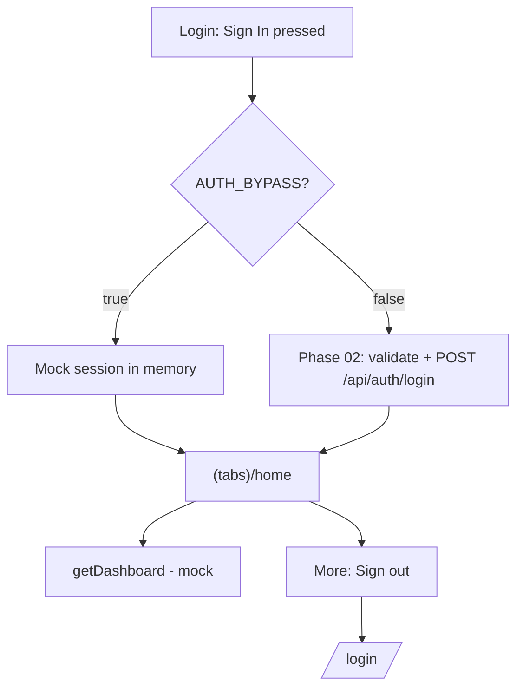

# Phase 03 – Dashboard (mock data) + temporary login bypass

## 1. Summary
Adds a tabbed shell (Home, Transactions, Insights, Assistant, More) and a Home dashboard backed by **mock data** behind a service layer. A temporary flag, `EXPO_PUBLIC_AUTH_BYPASS`, lets the Login button skip validation and the API and open the dashboard with an in-memory mock session. The real Phase 02 auth code is untouched and runs when the flag is `false`.

## 2. New files created
| Path | Purpose |
|---|---|
| `src/config/flags.ts` | `AUTH_BYPASS` (default true when unset) and `DASHBOARD_MOCK_FAIL` |
| `src/auth/mockUser.ts` | Mock user for the bypass |
| `src/app/(tabs)/_layout.tsx` | Tabs layout, auth guard, tab bar styling |
| `src/app/(tabs)/home.tsx` | Dashboard screen |
| `src/app/(tabs)/transactions.tsx`, `insights.tsx`, `assistant.tsx` | Placeholder screens |
| `src/app/(tabs)/more.tsx` | Language row (→ `/language`) and Sign out |
| `src/components/Icon.tsx` | Shared stroke icons (tabs, stat cards, bell) |
| `src/features/dashboard/types.ts`, `mock.ts`, `dashboardService.ts`, `useDashboard.ts` | Data contract, mock data, `getDashboard()`, hook |
| `src/features/dashboard/DashboardHeader.tsx`, `Greeting.tsx`, `SpendingCard.tsx`, `WeeklyBars.tsx`, `StatGrid.tsx`, `StatCard.tsx`, `DashboardSkeleton.tsx` | Dashboard UI |
| `src/utils/money.ts`, `src/utils/intl.ts` | `formatMoney`; month/weekday names via Intl |
| `docs/phase-03-dashboard-bypass.md` | This document |

## 3. Files changed
| Path | What changed |
|---|---|
| `src/auth/AuthProvider.tsx` | `AuthUser.firstName?`; bypass branches in `signIn`, `signOut`, `restoreSession` |
| `src/features/auth/useLogin.ts` | Bypass branch at the start of `submit` |
| `src/app/language.tsx` | Continue goes to `/home` when already authenticated (opened from More) |
| `src/components/PlaceholderScreen.tsx` | Optional `titleKey` |
| `src/i18n/en.ts`, `ar.ts` | Tab, greeting, dashboard and More strings; removed `home.*` |
| `src/theme/colors.ts`, `spacing.ts` | Success/orange/violet-soft colors, new sizes, tab bar shadow |
| `.env.example` | `EXPO_PUBLIC_AUTH_BYPASS`, `EXPO_PUBLIC_DASHBOARD_MOCK_FAIL` |
| `src/app/home.tsx` | Removed (replaced by `(tabs)/home.tsx`) |

## 4. Business logic applied
- **Bypass flag:** `AUTH_BYPASS = EXPO_PUBLIC_AUTH_BYPASS !== 'false'`, read only in `src/config/flags.ts`. When true: Sign In skips validation and the API (empty fields work) and sets the mock session (in memory only) then `router.replace('/home')`; `restoreSession` returns unauthenticated at once (no secure-store, no network); `signOut` clears the mock session and More goes to `/login`. When false, behavior is exactly Phase 02. Each bypass branch carries `// TEMP: remove when dashboard is connected to backend`.
- **Route guard:** `(tabs)/_layout.tsx` renders `<Redirect href="/login" />` unless `status === 'authenticated'`. Splash order is unchanged; with bypass it ends at `/login`. Android back on Home exits the app.
- **Greeting:** hour < 12 morning, < 17 afternoon, else evening; name is `firstName`, else `username`; avatar shows initials.
- **Money:** amounts are decimal strings. `formatMoney(amount, currency, language)` returns `<CODE> <grouped>`; the currency comes from the data. Decimals are 3 for KWD/BHD/OMR and 2 otherwise, shown only when the value is not whole (`SAR 4,250`). Digits are Western in both languages. The fraction is never converted to a float and is truncated, not rounded, if the server sends extra digits. The chart converts to numbers for bar heights only.
- **Change % color:** spending down (≤ 0) is green with a down arrow; up is red with an up arrow. The value shown is the absolute percentage.
- **Month and weekday names** come from `Intl.DateTimeFormat` (Gregorian, Western digits). `weekly.day` 0 = Monday.
- **Data layer contract:** `getDashboard(): Promise<DashboardData>` is the only place to change for the backend. The mock waits 500 ms and throws when `EXPO_PUBLIC_DASHBOARD_MOCK_FAIL=true`. `useDashboard` returns `{ data, loading, error, refresh }`; pull-to-refresh calls `refresh`; the skeleton shows on first load and the error state (with Retry) when there is no data.

## 5. Flow after this integration

Future flow when connected: Dashboard → gateway → services:
- `GET /api/reports/income-vs-expenses`
- `GET /api/reports/spending-summary`
- `GET /api/reports/daily-spending`
- `GET /api/budgets/current`
- `GET /api/subscriptions/summary`
- `GET /api/goals`
- `GET /api/notifications/unread-count`

## 6. Design mapping + deviations
- The reference's Home Dashboard is the **web** layout and has no mobile tab bar, so the mobile layout (header, greeting, spending card with 7 bars, 2×2 stat cards) and the tab bar are adapted from it.
- The Home tab file is `(tabs)/home.tsx` (route `/home`), not `index.tsx`, because `(tabs)/index.tsx` would also map to `/` and clash with the Splash route.
- Stat icon tiles use blue, violet, amber and green; the tallest bar is violet and the others light blue.
- Bell has a static red dot (no notification count yet).
- Arabic strings are my own translations and need native review.

## 7. How to remove the bypass later
1. Delete `src/config/flags.ts`' `AUTH_BYPASS` and `src/auth/mockUser.ts`.
2. In `src/auth/AuthProvider.tsx`, delete the three `if (AUTH_BYPASS)` blocks, the `MOCK_USER` and `AUTH_BYPASS` imports.
3. In `src/features/auth/useLogin.ts`, delete the bypass block and the import.
4. Remove `EXPO_PUBLIC_AUTH_BYPASS` from `.env.example` and any `.env.local`.
5. Replace the mock in `src/features/dashboard/dashboardService.ts` with gateway calls (then delete `mock.ts` and `DASHBOARD_MOCK_FAIL`).
Search for `TEMP:` to find every spot.

## 8. How to run and known limitations
Set `EXPO_PUBLIC_API_BASE_URL` as in Phase 02 only when `EXPO_PUBLIC_AUTH_BYPASS=false`; with the bypass no backend is needed. Restart Expo after changing env values. Limitations: only the Transactions stat card navigates; the bell and Budget/Subscriptions/Savings cards do nothing; onboarding still shows on every launch (previous temporary flag); weekly chart order flips in RTL (follows layout direction); no unit-test runner exists, so `formatMoney` is not covered by tests.

## 9. Next phase
Phase 04: connect the dashboard to the real reports/budget/subscription/goal/notification endpoints and remove the bypass.
