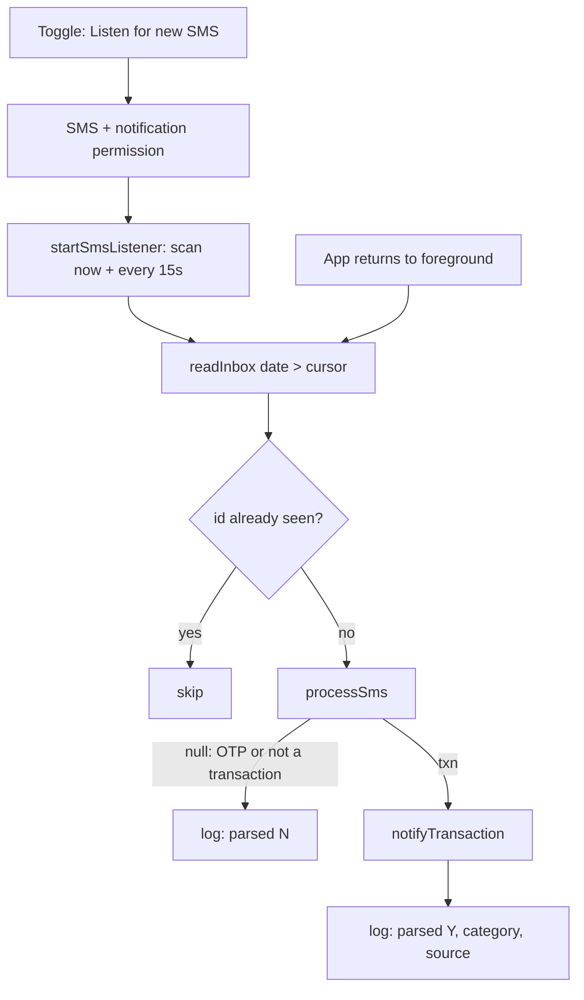

# Phase 04 – New-SMS listener + local notification (Android)

## 1. New files created
| Path | Purpose |
|---|---|
| `src/features/sms/processSms.ts` | `processSms(sms)` → parse → categorize → `{ txn, category, source, confidence? }` or `null` |
| `src/features/notifications/notify.ts` | `ensureNotificationPermission()`, `buildNotificationContent()`, `notifyTransaction()` |
| `src/features/sms/listener.ts` | `startSmsListener(onSms)` / `stopSmsListener()` / `scanInbox()` (inbox polling + cursor + dedupe) |
| `src/features/sms/useSmsPipeline.ts` | Hook that wires listener → `processSms` → notification, resume scan, last-20 log |
| `src/features/sms/SmsListenerPanel.tsx` | "Listen for new SMS" toggle + live log on the debug screen |
| `src/features/sms/pipeline.test.ts` | 8 Vitest tests |
| `docs/phase-04-listener-notification.md` | This document |

## 2. Files changed
| Path | What changed |
|---|---|
| `src/features/sms/SmsDebugScreen.tsx` | Shows `SmsListenerPanel`; "Parse + categorize" now uses `processSms` (no duplicated pipeline) |
| `src/i18n/en.ts`, `ar.ts` | Two new labels (toggle, "Parsed") |
| `app.json` | `expo-notifications` plugin; `POST_NOTIFICATIONS` permission |
| `package.json` | `expo-notifications` (the standard Expo library for local notifications; no alternative needed) |

## 3. Business logic applied
- **Listener choice: inbox polling every 15 s** with a `lastSeenDate` cursor, built on the Phase 01 reader. I did not use `react-native-android-sms-listener` (last release 2022, same unmaintained Gradle setup as the SMS reader, so it would need another patch) and I did not write a native BroadcastReceiver. Polling needs no new native code. A runtime receiver would also only run while the app process is alive, like polling.
- **Cursor:** `lastSeenDate` is kept in memory and also saved in AsyncStorage (`smsLastSeenDate`). The first time the listener starts, the cursor is "now", so old history is never replayed. Each scan reads `date > cursor`, in ascending order, and moves the cursor forward. Saving the cursor is what lets the resume scan catch SMS that arrived while the app was closed. It is not a transaction store (that is Phase 05).
- **Dedupe:** an in-memory `Set` of SMS ids ensures one SMS is processed once per app run, even if polling and the resume scan overlap. Scans never run concurrently.
- **Resume scan:** while the toggle is on, an `AppState` change to `active` triggers an immediate scan, using the same pipeline.
- **Pipeline per new SMS:** `processSms` → if `null`, only logged; otherwise `notifyTransaction`. The log keeps the last 20 items (time, parsed Y/N, category, source).
- **Notification:** channel `transactions` (default importance), local only, immediate. Title `<amount> <currency> · <merchant or bank>`, body `<category> · Debit|Credit[ · card ****1234]`. Credits show `Income` (from `categorize`). The raw SMS body is never sent. Amount is the plain parsed string (for example `1250.00 PKR`) and the text is English only. Both are simplifications.
- **Permissions:** turning the toggle on requires SMS permission (already granted via the permission screen) and asks for notification permission. If notifications are denied, SMS are still processed and logged but nothing is shown. A foreground notification handler makes banners show while the app is open.
- Not started globally; only the debug-screen toggle starts it.

## 4. Flow after integration


## 5. Commands
```bash
npm test
npx tsc --noEmit
npx expo lint

# device run (USB), see Phase 03 for the model API
cd D:\Fintech\merchant_api_project
uvicorn main:app --host 0.0.0.0 --port 8000
adb reverse tcp:8000 tcp:8000
cd D:\Fintech\fintech-mobile-app
npx expo prebuild --platform android --clean     # native rebuild is required (new permission/plugin)
npx expo run:android --device
```
In the app: dashboard → "SMS reader (dev only)" → allow SMS → turn on **Listen for new SMS** → allow notifications. Then send the phone a test SMS, for example from another phone: `Meezan Card ending 1234: purchase of Rs. 1,250.00 at KFC LAHORE on 12-May-26.` The sender must resemble a bank name for bank-specific rules; the generic rule handles any sender. Within about 15 seconds a notification should appear and the log should show a new line.
- Emulator smoke test: `adb emu sms send MEEZAN "Meezan Card ending 1234: purchase of Rs. 1,250.00 at KFC LAHORE on 12-May-26."`
- Resume test: leave the toggle on, background the app, send an SMS, reopen the app. The scan runs immediately.
- Killed-app test: send an SMS while the app is closed, reopen, and turn the toggle on again. The saved cursor makes the missed SMS be processed.

## 6. Known limits
- Polling only runs while the app's JS is alive. Android pauses it soon after the app goes to the background, so there is no live notification for a killed or long-backgrounded app. The resume scan covers this once you reopen (no headless task, as requested).
- The toggle resets when the app restarts and is not auto-started.
- Up to 15 s delay while the app is open.
- Only the latest 50 inbox messages per scan; a burst of more than 50 between scans would lose the oldest.
- Dedupe is in memory only. After a restart the cursor (date) prevents repeats, but two SMS with the same millisecond timestamp could be skipped.
- A notification is built for every parsed transaction, including ones the app has already shown (no persistence until Phase 05).
- English notification text, plain amount format, Android only.
- Not verified on a device in this environment (no Android SDK here); tests cover the logic with mocks.
