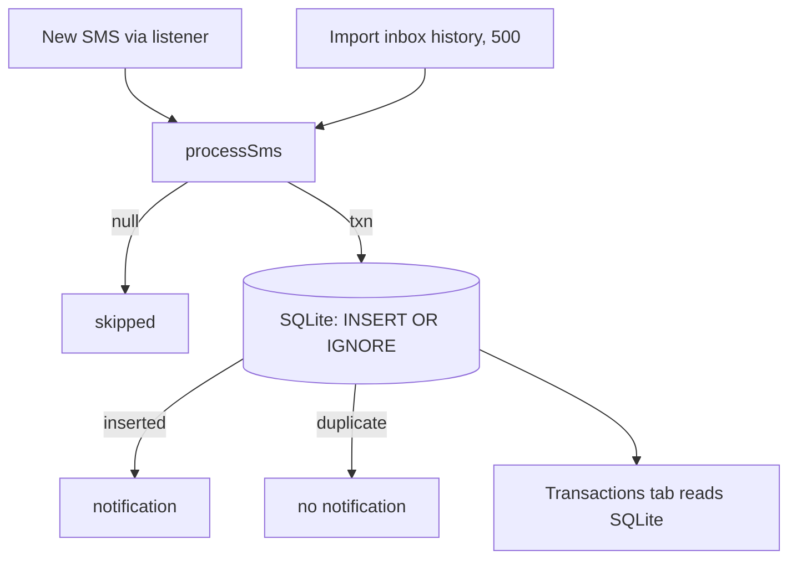

# Phase 05 – Local SQLite transactions

## 1. New files created
| Path | Purpose |
|---|---|
| `src/features/transactions/db.ts` | Opens `nafaqati.db` once and creates the `transactions` table and index |
| `src/features/transactions/transactionsRepo.ts` | `saveTransaction()`, `listTransactions()`, `transactionKey()` |
| `src/features/transactions/TransactionRow.tsx` | One row: merchant/bank, category · date, signed amount |
| `src/features/transactions/transactionsRepo.test.ts` | 4 tests (expo-sqlite mocked) |
| `src/features/sms/importHistory.ts` | One-off scan of the SMS inbox into SQLite |
| `docs/phase-05-sqlite-transactions.md` | This document |

## 2. Files changed
| Path | What changed |
|---|---|
| `src/features/sms/useSmsPipeline.ts` | After `processSms`, saves the transaction. Notifies only when the row is new. Log shows `duplicate` |
| `src/features/sms/SmsListenerPanel.tsx` | "Import inbox history" button and its result line |
| `src/app/(tabs)/transactions.tsx` | Replaced the placeholder with a list read from SQLite (pull to refresh, reloads on focus) |
| `src/i18n/en.ts`, `ar.ts` | Three new strings |
| `package.json`, `app.json` | `expo-sqlite` (Expo's own SQLite library) and its config plugin |

## 3. Business logic applied
- **Table `transactions`:** `dedupe_key` (unique), `sms_id`, `bank`, `type`, `amount` (TEXT decimal string, never a float), `currency`, `merchant`, `card_last4`, `date`, `category`, `source`, `confidence`. **The raw SMS body is not stored.**
- **Dedupe:** key = `date | type | amount | currency | cardLast4`, with `INSERT OR IGNORE`. The SMS id is stored but not used for uniqueness, because ids can be reused after a message is deleted.
- **Live flow:** new SMS → `processSms` → `saveTransaction`. A notification is sent only if a row was inserted, so restarts no longer repeat notifications. If saving fails, the user is still notified (simplest choice).
- **History import:** reads the latest 500 inbox messages, processes them 10 at a time (the model may be called for unknown merchants), and saves each parsed one. It shows `scanned / saved / skipped`. Already-saved duplicates count in neither saved nor skipped. It does not move the listener cursor.
- **Deleted SMS:** a saved transaction is not affected when the original SMS is deleted. A message deleted before the app ever saw it is lost.
- **Transactions tab:** newest first (max 200), debits red with `-`, credits green with `+`. Amounts use the stored currency.

Not done (not requested): manual category edit, delete, search, retention limits, and syncing to the backend. The dashboard cards are still mock data. Two different SMS with the same time, type, amount, currency and card would count as one.

## 4. Flow after integration


## 5. Commands
`expo-sqlite` is native code, so a **new dev build is required** (the previous APK does not contain it).
```bash
npm test
npx tsc --noEmit
npx expo lint

git add -A && git commit -m "Phase 05: SQLite transactions"
npx eas-cli@latest build --profile development --platform android
# install the new APK, then:
cd D:\Fintech\merchant_api_project
uvicorn main:app --host 0.0.0.0 --port 8000
adb reverse tcp:8000 tcp:8000
adb reverse tcp:8081 tcp:8081
cd D:\Fintech\fintech-mobile-app
npx expo start --dev-client
```
Test: dashboard → "SMS reader (dev only)" → **Import inbox history** → open the Transactions tab. Run the import again: `saved` should be 0. Delete one of the imported SMS on the phone and reopen the tab: the row is still there.
