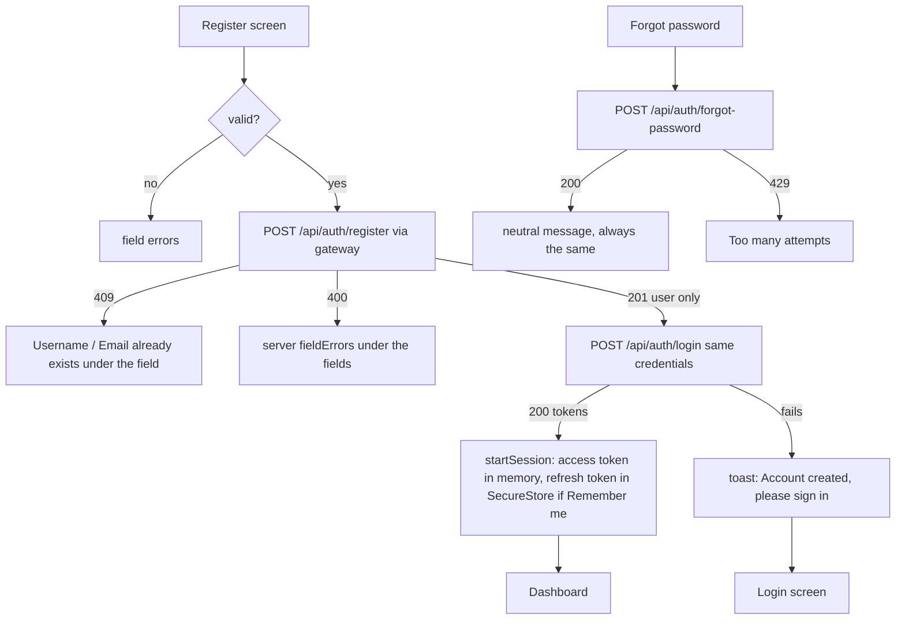

# Phase 06 – Connect the auth backend (register, forgot password, real login) – local

## 1. New files created
| Path | Purpose |
|---|---|
| `src/features/auth/validators.ts` | `validateRegister`, `validateEmail`: client-side copies of the auth-service rules (username `[a-zA-Z0-9._-]{3,50}`, password ≥ 8 characters and ≤ 72 bytes, names ≤ 100, email ≤ 255) |
| `src/features/auth/useRegister.ts` | Register form state and submit: validate → `POST /api/auth/register` → sign in with the same credentials |
| `src/features/auth/useForgotPassword.ts` | Forgot-password form state and submit |
| `src/features/auth/AuthScreen.tsx` | Shared layout (gradient, logo, heading) for the two new screens; same look as the login screen |
| `src/features/auth/validators.test.ts` | 7 Vitest tests |
| `src/api/errors.test.ts` | 6 Vitest tests for the error mapping |
| `src/auth/authApi.test.ts` | 4 Vitest tests for the request paths and bodies |
| `scripts/auth-smoke.ps1` | Checks register / login / refresh / logout through the gateway without the app |
| `docs/phase-06-auth-backend.md` | This document |

## 2. Files changed
| Path | What changed |
|---|---|
| `src/auth/authApi.ts` | Added `register()` and `forgotPassword()` |
| `src/api/errors.ts` | New `409` case: "Username already exists" / "Email already exists" become a field error on `username` / `email` |
| `src/app/register.tsx` | Was a placeholder; now the registration screen |
| `src/app/forgot-password.tsx` | Was a placeholder; now the request-a-reset-link screen |
| `src/i18n/en.ts`, `ar.ts` | 35 new keys each (register, forgot, validation, `errors.userExists`) |
| `.env.local` (git-ignored, not committed) | `EXPO_PUBLIC_API_BASE_URL=http://10.0.2.2:8080`, `EXPO_PUBLIC_AUTH_BYPASS=false` |

Not changed: `AuthProvider`, `session`, `tokenStore`, `useLogin`, `login.tsx`. The login, token refresh (single-flight, rotation, proactive timer) and logout code from Phase 02 already matched the backend; this phase only turns the bypass off and adds what was missing.

## 3. Business logic applied
- **Always through the API gateway (port 8080).** The app calls `/api/auth/**` on the gateway, never on auth-service (8081) directly. The gateway adds the JWT check, the Redis rate limits and the circuit breaker. In production only the gateway should be reachable from outside.
- **Register returns no tokens.** auth-service answers `201` with `{ id, username, email, role }` only. After a successful register the app signs in with the same username and password (`rememberMe: false`) and opens the dashboard. If that sign-in fails, the user sees a toast "Account created. Please sign in" and lands on the login screen.
- **Register fields sent:** `username`, `email`, `firstName`, optional `lastName` (omitted when empty), `password`. "Confirm password" is checked in the app only.
- **Duplicate user:** `409` with message `Username already exists` or `Email already exists` is shown under the matching field. Any other 409 shows a general banner.
- **Server field errors (400)** from `fieldErrors` are shown under the field with the same name; the app's own validation runs first and catches most of them.
- **Locked account looks like a wrong password.** After 5 failed logins auth-service locks the account for 15 minutes but still answers `401 Invalid credentials`, so the app cannot show a "locked" message. This is the backend's choice (no account enumeration).
- **Forgot password:** sends `{ email }` and shows the same neutral message ("If an account exists for this email…") whether or not the email exists. The backend allows 3 reset requests per hour per account and the gateway limits this route per IP, so a `429` shows "Too many attempts".
- **Reset password is not in this phase.** The email contains a link `<FRONTEND_BASE_URL>/reset-password?token=…`. Opening it in the app needs a deep link (the app scheme is `nafaqati`) and a screen for `POST /api/auth/reset-password`. In development (`MAIL_MODE=log`) the email is printed in the auth-service console, which is enough to test the request side.
- **Bypass:** `EXPO_PUBLIC_AUTH_BYPASS` still defaults to `true` when unset, because the dashboard is still mock data. Local testing of real auth needs `EXPO_PUBLIC_AUTH_BYPASS=false`, which `.env.local` sets.
- **No tokens are logged or written to the docs.** The smoke script prints PASS/FAIL lines only.

## 4. Flow after integration


## 5. Commands
```bash
npm test
npx tsc --noEmit
npx expo lint
```

Run the backend locally (each service has its own `.env`; `JWT_SECRET` must be the **same value** in auth-service and api-gateway, at least 32 bytes):
1. PostgreSQL with database `fintech_auth` (auth-service dev defaults), Redis on `localhost:6379`, and Kafka (auth-service publishes `UserRegistered`; without Kafka register answers `503`).
2. `cd D:\Fintech\auth-service` then `.\mvnw spring-boot:run` (port 8081, dev profile is the default).
3. `cd D:\Fintech\api-gateway` then `.\mvnw spring-boot:run` (port 8080).

Check the backend **before** the app:
```powershell
cd D:\Fintech\fintech-mobile-app
.\scripts\auth-smoke.ps1                                   # http://localhost:8080
.\scripts\auth-smoke.ps1 -BaseUrl http://192.168.1.20:8080 # your PC's LAN IP
```
It runs 10 checks (health, register 201, duplicate 409, wrong password 401, login with tokens, refresh with rotation, old refresh token rejected, forgot-password 200, logout-all with and without a JWT). All should print PASS.

Run the app against it:

| Where the app runs | `EXPO_PUBLIC_API_BASE_URL` in `.env.local` |
|---|---|
| Android emulator | `http://10.0.2.2:8080` (default in this phase) |
| Phone on USB | `http://localhost:8080` after `adb reverse tcp:8080 tcp:8080` |
| Phone on the same Wi-Fi | `http://<PC-LAN-IP>:8080` (allow port 8080 in Windows Firewall) |

```bash
npx expo start --clear      # restart after any .env.local change; EXPO_PUBLIC_ values are read at bundle time
```
Android allows plain HTTP in this app (`usesCleartextTraffic`); iOS would block it, and a real deployment needs HTTPS (see the card notes: no domain yet).

Manual test list in the app:
1. Register with a new username and email → lands on the dashboard.
2. Register again with the same username → error under Username; with the same email → error under Email.
3. Sign out, sign in with username, then with email.
4. Wrong password five times → still "Invalid credentials" (locked for 15 minutes, by design).
5. Tick "Remember me", close and reopen the app → still signed in (refresh token restored).
6. Forgot password → neutral message; the reset link appears in the auth-service console.
7. Stop the gateway → "Check your connection"; start it again and retry.
