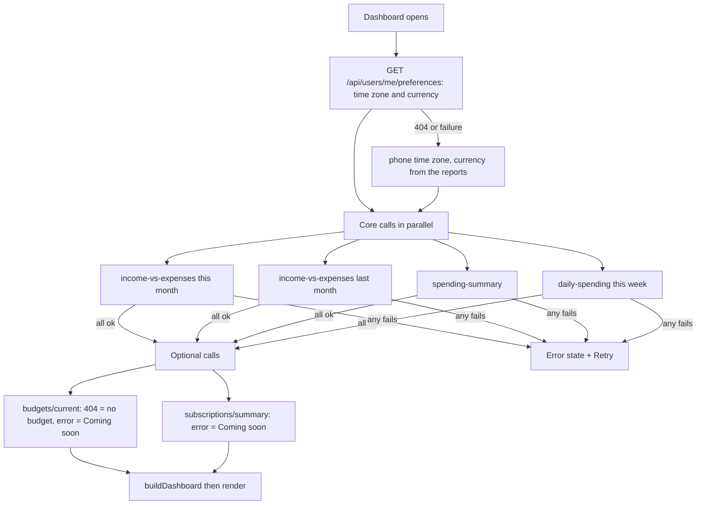

# Phase 07 – Dashboard connected to the backend (reports, budget, subscriptions)

## 1. New files created
| Path | Purpose |
|---|---|
| `src/features/dashboard/dashboardApi.ts` | One function per backend call (`income-vs-expenses`, `spending-summary`, `daily-spending`, `budgets/current`, `subscriptions/summary`, `users/me/preferences`). Each checks the response shape and returns plain numbers/strings |
| `src/features/dashboard/dashboardBuilder.ts` | Pure functions: dates in the user's time zone, month and week ranges, currency choice, month-over-month change, and `buildDashboard()` that produces `DashboardData` |
| `src/features/dashboard/dashboardBuilder.test.ts` | 14 Vitest tests |
| `src/features/dashboard/dashboardApi.test.ts` | 8 Vitest tests |
| `src/features/dashboard/dashboardService.test.ts` | 5 Vitest tests |
| `scripts/dashboard-smoke.ps1` | Creates a throwaway user and known transactions, then checks the dashboard endpoints through the gateway |
| `docs/phase-07-dashboard-backend.md` | This document |

## 2. Files changed
| Path | What changed |
|---|---|
| `src/features/dashboard/dashboardService.ts` | `getDashboard()` now calls the backend; the mock is kept for the login-bypass mode |
| `src/features/dashboard/types.ts` | Added `budgetState` and `subscriptionsState` (`'ready'` or `'unavailable'`); comments on `weekly`, `budgetUsedPercent` (null means no active budget) and `savings` |
| `src/features/dashboard/mock.ts` | The two new fields, both `'ready'` |
| `src/features/dashboard/StatGrid.tsx` | Budget and Subscriptions tiles show "Coming soon" when their state is `'unavailable'` |
| `src/i18n/en.ts`, `ar.ts` | `dashboard.comingSoon` |

Not changed: the screen (`home.tsx`), `useDashboard`, `SpendingCard`, `WeeklyBars`, `StatCard`, `Greeting`. They already read `DashboardData`.

## 3. Business logic applied
- **Always through the gateway** with the user's JWT (the shared `api` client, which already refreshes an expired token once on a 401).
- **Period:** the current calendar month in the user's time zone. The zone comes from the saved preferences (`GET /api/users/me/preferences`); with none (404) or if that call fails, the phone's zone is used. "Today" is the date in that zone, not the phone's.
- **Core numbers** (four calls in parallel; if any one fails the dashboard shows its existing error state with Retry):

| Dashboard field | Source |
|---|---|
| Total spending | `GET /api/reports/income-vs-expenses` for this month, `totalExpenses` |
| Change vs last month | the same call for the previous month; `(this - last) / last x 100`, one decimal, signed. `0` when last month had no spending |
| Savings | `net` (income minus expenses) of this month |
| Transaction count | `GET /api/reports/spending-summary`, `transactionCount` (completed expenses) |
| Weekly bars | `GET /api/reports/daily-spending` for the current Monday-to-Sunday week; one bar per day, `0.00` for days without spending |

- **Optional tiles** (fetched separately; a failure only affects its own tile, which shows **"Coming soon"**):
  - Budget: `GET /api/budgets/current`, `percentageUsed` rounded. A `404` means no budget this month and shows `-`; any other failure shows "Coming soon".
  - Subscriptions: `GET /api/subscriptions/summary`, `countsByStatus.CONFIRMED`.
- **Currency:** the user's preferred currency if the reports contain it; otherwise the currency with the most spending this month; otherwise the preference, then `PKR`. Currencies are never added together.
- **Money formatting:** amounts are kept as decimal strings with the currency's decimals (3 for KWD, BHD, OMR; otherwise 2), then formatted by the existing `formatMoney`.
- **Bypass mode:** with `EXPO_PUBLIC_AUTH_BYPASS=true` there is no token, so the dashboard keeps showing the mock data (`DASHBOARD_MOCK_FAIL=true` still forces the error state).
- **A new user sees zeros**, not an error: no transactions means every amount is `0.00`.

## 4. Known gaps
- **Transactions do not reach the backend yet.** The app keeps SMS transactions in its local SQLite database; nothing posts them to `POST /api/transactions`. Until that sync exists, a real user's dashboard shows zeros. The smoke script creates transactions through the API to prove the numbers.
- The greeting still shows the username: `GET /api/users/me` (first name) is not wired in.
- No "safe to spend", insights or upcoming-bills tiles; the app's dashboard does not have them.

## 5. Flow after integration


## 6. Commands
```bash
npm test
npx tsc --noEmit
npx expo lint
```

Backend (from `D:\Fintech`; PostgreSQL, Redis and Kafka must be up, see Phase 06):
```powershell
.\scripts\local\start-stack.ps1 -Only transaction-service,reports-analytics-service,budget-service,subscription-service
cd D:\Fintech\fintech-mobile-app
.\scripts\dashboard-smoke.ps1          # 10 checks with known numbers (400 spent, 1000 income, 600 net)
```
The gateway, auth-service and user-service must also be running. If `/api/users/me/preferences` answers `503`, user-service is stuck: restart it. The dashboard still works without it.

In the app (Expo Go or a development build): sign in with a real account (`EXPO_PUBLIC_AUTH_BYPASS=false` in `.env.local`), restart with `npx expo start --go --clear`. A new account shows zeros. To see numbers, add transactions to that account through the API (the smoke script shows the request) and pull to refresh.

**Web.** `npm start` and `npm run web` now run the dev server on port **3000**. The gateway's development CORS list only allows `http://localhost:3000` and `http://localhost:5173`; from any other port the browser blocks every API call and the app shows "Check your connection" (phones are not affected, CORS is a browser rule). Port 3000 also avoids Metro's default 8081, which auth-service uses. Web-only fixes made in this phase:
- `src/features/transactions/db.web.ts`: the SMS transaction store is phone-only, so web never bundles expo-sqlite (its `.wasm` broke the web build).
- `src/features/sms/smsPermission.ts`: `PermissionsAndroid` is read only when called (it does not exist on web and crashed server rendering).
- `src/i18n/LanguageProvider.tsx`: on web, Arabic sets `dir="rtl"` on the page instead of calling `DevSettings.reload()`, which does not exist on web.
- `src/utils/layoutDirection.ts` and `src/components/svgA11y.ts`: the `direction` style and the `accessible` prop are given to native only; web gets nothing or `role`/`aria-*` (both caused console warnings).

Checked in headless Edge: `/`, `/language`, `/login`, `/register`, `/forgot-password`, `/sms-debug` in English and with Arabic saved, then a real sign-in through the form to `/home` with real dashboard data: no console errors or exceptions.

Manual test list:
1. New account: all amounts are `0.00`, Budget shows `-`, no error.
2. After adding transactions: total, change, savings, count and the weekly bars match the data.
3. Stop budget-service: only the Budget tile changes to "Coming soon".
4. Stop reports-analytics-service: the dashboard shows "Could not load your dashboard"; start it and tap Retry.
5. Switch the app language to Arabic: "Coming soon" appears as "قريبًا".

## Faster opening (added later)

The dashboard is still built only from the backend (reports, budget and subscription services); no API contract changed. Only when and how the app asks for it:
- **Loads at app open.** As soon as an account is known (a restored session, a sign-in), `prefetchDashboards` (`src/features/dashboard/dashboardStore.ts`) fetches the 1, 3 and 6 month dashboards in the background. The splash screen restores the saved login while it plays instead of after it, so the numbers are usually ready when Home appears. Nothing waits for them: Home never holds the splash.
- **In-memory store for every range.** Home and the range tabs read from the store, so moving 1M, 3M, 6M and back needs no request. Data younger than 2 minutes is not fetched again; older data is shown and replaced quietly when the new numbers arrive. A range that is being fetched again never shows a spinner (only a pull-down by the person does).
- **Saved copy on the phone.** `src/storage/dashboardCache.ts` keeps the last dashboards and the account's preferences, so a cold start shows numbers at once. Cleared on sign out.
- **Kept current, so old numbers are rare.** All ranges are fetched again after a transaction sync that sent rows, after adding or deleting a cash expense or changing a category, and when the app returns to the foreground (if older than 2 minutes).
- **Fewer waves.** Cached preferences no longer block the reports, and the optional sections start together with the four core reports.
- **Animation.** A shimmer skeleton for the very first load and cards that fade up one after another. Every number on the dashboard (total spending, the four tiles, income, expenses, net, each category amount and percent, this month's savings) rolls up from 0 to its value, and rolls to the new value when it changes. The weekday bars, the savings trend bars, the income/expense bars and the category bars grow to their size (and slide when the range changes); the heatmap cells pop in one after another. All respect the phone's "reduce motion" setting.
- **Insights** also keeps the last result of each range in memory: coming back to the tab or a range shows it at once and fetches again behind it. Transactions and the other tabs still load on open.
- Test: open the app, close it, turn off the network, open again: the last numbers show. Sign out and in as another user: nothing from the first account appears. Switch 1M, 3M, 6M, 1M: no waiting.

