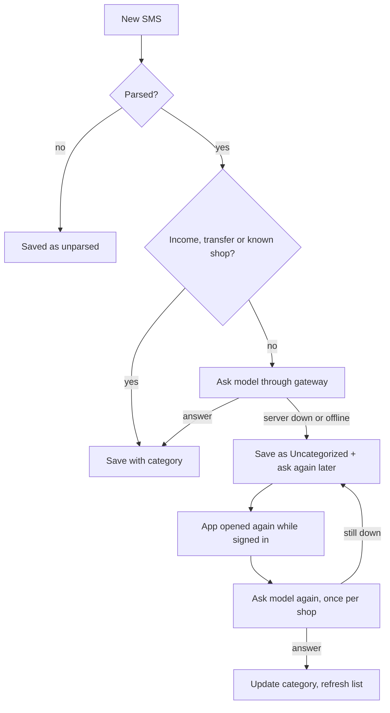

# Phase 08 – Connect the app to the model (category for each SMS)

In short: every money SMS the app reads gets a category (Food, Fuel, Health…). When the app cannot
reach the model, it remembers the SMS and asks again later. Nothing is lost.

## 1. New files
| Path | What it does |
|---|---|
| `src/features/categorizer/retryPending.ts` | Asks the model again for transactions it could not categorize before |
| `src/features/categorizer/useRetryPendingPredictions.ts` | Runs that retry while the user is signed in: at start, when the app comes back to the screen, and when the model works again |
| `src/features/categorizer/certainty.ts` | One rule that says if a category is trusted, unsure, or missing (used by task #7 and #8) |
| `src/features/categorizer/modelClient.test.ts` | 14 tests |
| `src/features/categorizer/retryPending.test.ts` | 7 tests |
| `src/features/categorizer/certainty.test.ts` | 4 tests |
| `docs/phase-08-model-prediction.md` | This document |

## 2. Changed files
| Path | What changed |
|---|---|
| `src/features/categorizer/modelClient.ts` | Calls the model through the gateway with the user's login token. Remembers answers, limits calls, and stops quickly when the model is down (see below) |
| `src/features/categorizer/categorize.ts` | Says when a model call failed, so the SMS can be retried. Split into small parts so the retry uses the same rules |
| `src/features/sms/processSms.ts` | Passes the "retry later" information on |
| `src/features/transactions/db.ts` | New columns for the retry (see below) |
| `src/features/transactions/transactionsRepo.ts` | Saves and reads the retry information. The transaction list no longer reads hidden columns |
| `src/app/(tabs)/_layout.tsx` | Starts the retry |
| `src/app/(tabs)/transactions.tsx` | Refreshes the list when a retry changed a category |
| `src/config/env.ts`, `.env.example` | Model server port is now **8087** (was 8000) |
| Tests | Categorizer, fallback, pipeline and repository tests updated |

Backend, in the `api-gateway` repo:
| Path | What changed |
|---|---|
| `src/main/resources/application.yml` | The `ai-service` route now removes `/api/ai-service` from the path, so `/api/ai-service/predict` reaches the model as `/predict` |
| `ApiGatewayApplicationTests.java` | 1 test for this |

## 3. How it works

### Which way the app talks to the model
- **Signed in:** app → gateway (port 8080) → model server (port 8087). The gateway checks the login token.
- **Login bypass mode** (`EXPO_PUBLIC_AUTH_BYPASS=true`, for development only): there is no token, so the app talks to the model server directly at `EXPO_PUBLIC_API_URL`.

### How a category is chosen (same as before)
1. Money received → **Income**. Bank transfer (Raast, IBFT, IBAN) → **Transfers**. No model call.
2. Shop is in the app's own list → that category. No model call.
3. Otherwise ask the model. The server tries its ML model, then its list of verified shops, then Gemini.
4. Nobody knows → **Uncategorized**.

### When the model cannot be reached
- The SMS is saved as **Uncategorized** and marked "ask again later".
- The app asks again while the user is signed in (also when they stay signed in with "remember me"):
  - when the app starts,
  - each time the app comes back to the screen,
  - as soon as the model answers again after being down (for example, when a new SMS gets a real answer).
- Nothing is retried while the app is closed.
- It asks **once per shop**, even if the shop appears in many SMS.
- If the server says no to the same SMS 5 times, the app stops asking. Being offline or the server being down does **not** count toward the 5.
- Old Uncategorized transactions (saved before this phase) are asked again once.

New database columns (added automatically when the app updates):
| Column | Meaning |
|---|---|
| `needs_prediction` | 1 = ask the model again later |
| `prediction_attempts` | How many times the server said no to this SMS |
| `retry_text` | The SMS text with every number removed. Kept only when the server also has to find the shop name, and deleted after it works |

### Protecting the model server
- The same question is answered from memory for 10 minutes.
- At most 3 model calls run at the same time in the whole app.
- When the model is down, calls stop at once for 30 seconds instead of each waiting 15 seconds. An import of 500 SMS with no server now takes about 15 seconds, not 12 minutes.

### Trusted or not (for task #7 and #8)
| Result | When | What the user sees later |
|---|---|---|
| Trusted | Own list, verified shops, rules, ML answer at 0.70 or more, **any Gemini answer** | Nothing to do |
| Unsure | ML answer below 0.70 | Asked to confirm |
| Uncategorized | Nobody knew the category | Asked to pick one |

We do not ask Gemini how sure it is. A language model almost always says it is sure, even when it is wrong.
With today's server, an ML answer below 0.70 never comes back, so in practice only Uncategorized
transactions will ask the user.

## 4. Known gaps
- Transactions still stay on the phone. Sending them to the backend is task #9.
- The category and its "trusted / unsure" label are not shown on screen yet. That is task #7.
- The user cannot fix a wrong category yet. That is task #8. It should call `resetModelClient()` after a fix, so the app does not reuse an old answer.
- If one Gemini call is slow and times out, the next 30 seconds of calls are also marked "ask again later". The retry fixes them.

## 5. Flow


## 6. Commands
```bash
npm test
npx tsc --noEmit
npx expo lint
```

Model server (from `D:\Fintech\merchant_api_project`, the port is now **8087**):
```powershell
.\venv\Scripts\activate
uvicorn main:app --host 0.0.0.0 --port 8087
```
Also start the gateway and auth-service (see Phase 06). The gateway forwards `/api/ai-service/**` to port 8087.

USB phone in bypass mode: `adb reverse tcp:8087 tcp:8087`.

**API keys:** Gemini and Groq keys go in `merchant_api_project/.env` only. Never put them in the app's
`.env.example`: that file is shared in git.

Manual test list (signed in, `EXPO_PUBLIC_AUTH_BYPASS=false`):
1. With the model running, read an SMS from a shop not in the app's list. It gets a category. The gateway log shows `POST /api/ai-service/predict 200`.
2. Stop the model. Read another new SMS. It shows **Uncategorized** at once (no long wait).
3. Start the model again. Close and reopen the app. The SMS gets its category and the Transactions list updates by itself.
4. Import history with many SMS from the same shop. The model server log shows one request for that shop.
