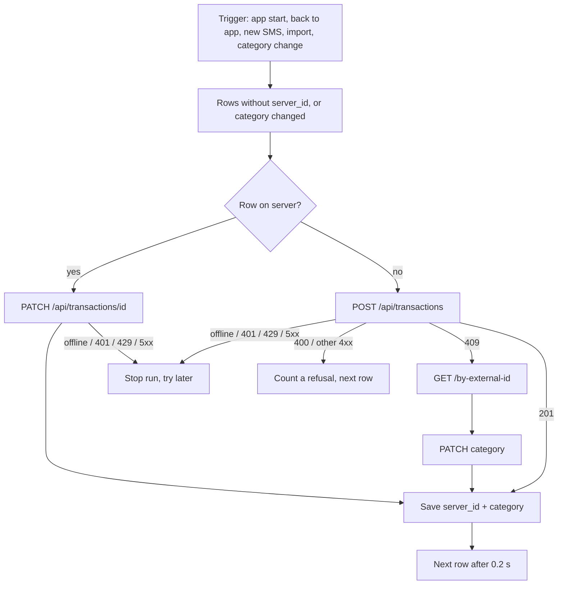

# Phase 11 – Send the phone's transactions to the server (sync)

## In one paragraph
The app reads bank SMS and saves each transaction on the phone (SQLite). Until now those transactions
never left the phone, so the dashboard, which reads from the server, showed zeros for real users. This
phase sends every saved transaction to the transaction service through the API gateway, and keeps its
category up to date when it changes later (the user fixes it, or the model answers late). If the phone
is offline or the server is down, nothing is lost: the app tries again later. **The SMS text is never sent.**

## 1. What was built

| Area | Change |
|---|---|
| App | A sync that sends new transactions (`POST`) and changed categories (`PATCH`) |
| App | Three new columns on the phone's `transactions` table to remember what the server has |
| Transaction service | One new read-only endpoint: find a transaction by the id the app gave it (`GET /api/transactions/by-external-id`) |

### New files (app)
| Path | What it does |
|---|---|
| `src/features/transactions/sync/syncMapping.ts` | Turns a phone transaction into the server's create request; maps categories |
| `src/features/transactions/sync/syncApi.ts` | The three server calls (create, find by external id, update category) |
| `src/features/transactions/sync/syncRepo.ts` | Reads which rows need syncing and records the result |
| `src/features/transactions/sync/transactionSync.ts` | The sync itself (order, pauses, errors) |
| `src/features/transactions/sync/useTransactionSync.ts` | Starts the sync at the right moments |
| `src/features/transactions/sync/*.test.ts` | 23 tests (mapping 9, sync 9, database 5) |
| `docs/phase-11-transaction-sync.md` | This document |

### Changed files (app)
| Path | What changed |
|---|---|
| `src/features/transactions/db.ts` | Migration: `server_id`, `synced_category`, `sync_attempts` |
| `src/app/(tabs)/_layout.tsx` | Starts the sync while signed in to a real account |
| `src/features/sms/useSmsPipeline.ts`, `importHistory.ts` | Announce new transactions, so they sync at once |
| `src/features/transactions/transactionsRepo.test.ts` | Schema version 13 |

### Changed files (transaction-service, branch `feature/lookup-by-external-id`)
| Path | What changed |
|---|---|
| `controller/TransactionController.java` | `GET /api/transactions/by-external-id?externalTransactionId=…` |
| `service/TransactionService.java` | `getByExternalId(userId, externalTransactionId)` |
| `repository/TransactionRepository.java` | `findByUserIdAndExternalTransactionIdAndDeletedAtIsNull` |
| `exception/TransactionNotFoundException.java` | Message for an external id |
| `TransactionApiTest.java` | 2 tests: found for the owner; 404 for another user or an unknown id; 400 without the parameter |

No database change on the server. No gateway change: `/api/transactions/**` is already routed and needs a JWT.

## 2. What is sent

`POST /api/transactions` for each transaction:

| Field | Value | Example |
|---|---|---|
| `amount` | The amount, as a number | `1250` |
| `currency` | Only PKR, AED, SAR, QAR, KWD, BHD, OMR (the server's list) | `PKR` |
| `type` | `DEBIT` (money out) or `CREDIT` (money in) | `DEBIT` |
| `merchant` | Shop or person name, if known (max 255) | `KFC LAHORE` |
| `description` | Bank, and the card's last 4 digits if known. **Not the SMS text** | `HBL · card ****1234` |
| `transactionDate` | The date printed in the SMS; if none, when the SMS arrived | `2026-10-28T12:00:00.000Z` |
| `externalTransactionId` | `sms:` + the phone's duplicate key (date, type, amount, currency, card) | `sms:1761650000000\|DEBIT\|1250.00\|PKR\|1234` |
| `category` | See the table below | `Food & Beverage` |

### Categories
| On the phone | Sent to the server | Why |
|---|---|---|
| The 15 spending categories, Salary, Other Income | The same | The user can only pick these, and they are the server's own list |
| Income (money received, set by the app) | Other Income | The server has no plain "Income" |
| Transfers (Raast / IBFT / IBAN) | UNCATEGORIZED | The server has no transfer category yet (decision below) |
| Person (money to an individual) | UNCATEGORIZED | Same |
| Uncategorized | UNCATEGORIZED | |
| Anything of the wrong kind (e.g. a spending category on money received) | UNCATEGORIZED | The server refuses it otherwise |

On the phone the user still sees "Transfers" or "Person". Only the server copy says UNCATEGORIZED.

**Decision taken:** a real `TRANSFERS` category would need changes in three services (transaction,
budget and notification service, which each keep a copy of the category list; budget-service rejects
events with an unknown category) and a decision whether transfers count as spending. That is left for
a separate card. When it is done, the app needs one line in `serverCategory()` and a migration that
clears `synced_category` on Transfers/Person rows, so they are re-sent.

## 3. How the sync works

### What the phone remembers
| Column | Meaning |
|---|---|
| `server_id` | The server's id for this transaction. Empty = not on the server yet |
| `synced_category` | The category the server last accepted. Different from `category` = the server needs an update |
| `sync_attempts` | How many times the server **refused** this row (bad data). After 3, the row is not sent again |

### When it runs
Only while signed in to a real account (not in login-bypass mode, which has no token):
- when the app starts,
- each time the app comes back to the screen,
- whenever transactions change: a new SMS, a history import (once at the end), a category change by the
  user, or a late answer from the model.

One run at a time. A request to sync during a run makes it do one more pass at the end, so nothing
waits for the next trigger.

### For each row (oldest first, up to 200 per pass)
1. **Not on the server yet:** `POST`. Save the returned id and the category sent.
2. **Already there, category changed:** `PATCH /api/transactions/{id}` with the new category.
3. **`POST` answered 409 (duplicate):** the server already has it (the app was closed before it saved
   the reply). Look it up with `GET /by-external-id`, save that id, then `PATCH` the category.

### Speed
One request at a time with a 0.2 s pause: about 5 requests a second. The gateway allows 10 a second per
user (burst 20). A first sync of 500 transactions takes about 2 minutes, in the background.

### Errors
| Server answer | What the app does |
|---|---|
| No answer (offline, timeout), 401, 408, 429, 5xx | Stops this run. Nothing is counted against the row. Tries again at the next trigger |
| 400, 404, other 4xx | Counts one refusal for that row and moves on to the next row |
| 3 refusals for one row | That row is not sent again (it would be refused forever) |
| Currency the server does not accept (e.g. USD) | Not sent. Stays on the phone only |

Nothing in the sync can crash the app: every error is caught.

## 4. Privacy
- Sent: amount, currency, type, shop or person name, bank, the card's last 4 digits, date, category.
- Never sent: the SMS text, the account balance, full card or account numbers.
- Personal category rules and feedback from Phase 10 stay on the phone (the server has no place for them yet).

## 5. Known gaps
- **Transfers and Person are UNCATEGORIZED on the server** (see the decision above). The dashboard counts
  them as uncategorized spending.
- **One phone, two accounts:** a transaction is sent to whichever account is signed in when it syncs.
  Once sent, it is not sent to the other account.
- **New phone:** transactions are not downloaded from the server. A new phone starts empty and reads SMS again.
- **Unsupported currencies** stay on the phone only.
- **Deleting:** SMS transactions cannot be deleted on the server (only manual ones can), and the app has no delete.
- Not yet tested end to end against the running services (see the manual test below).

## 6. Diagram


## 7. Commands
```bash
npm test
npx tsc --noEmit
npx expo lint
```
Transaction service (Docker must be running for the PostgreSQL test container):
```powershell
cd D:\Fintech\transaction-service
.\mvnw.cmd test
```

### Manual test (phone, real account)
Start the gateway, auth-service, transaction-service and reports-analytics-service. In `.env.local` set
`EXPO_PUBLIC_AUTH_BYPASS=false`, then `npx expo start --clear`.
1. Sign in. Import SMS history. Within a few minutes the dashboard shows real totals (pull to refresh).
2. Gateway log: `POST /api/transactions 201` for each, about 5 a second, no `429`.
3. Change a transaction's category in the app. The gateway log shows `PATCH /api/transactions/{id} 200`.
4. Turn on airplane mode, receive or import more SMS, turn it off and reopen the app. The new ones are sent.
5. Check in the database (`transactions` table of transaction-service) that no row contains SMS text.
